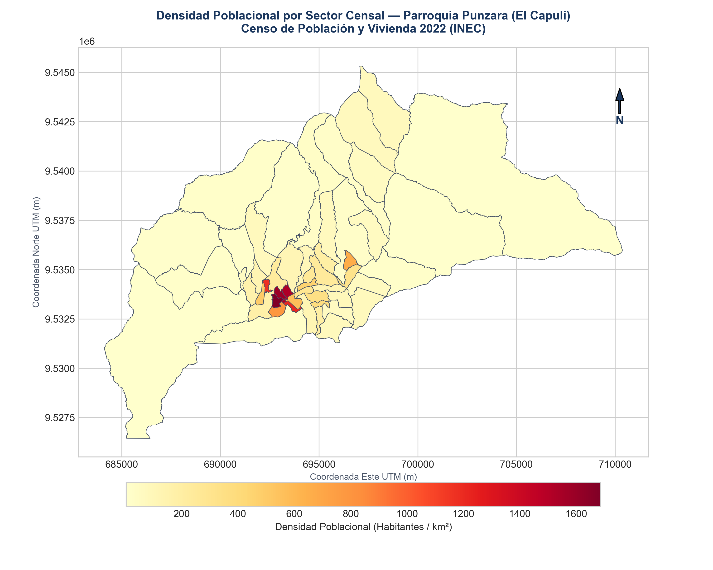
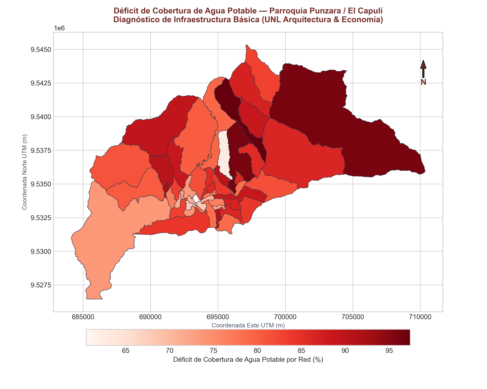
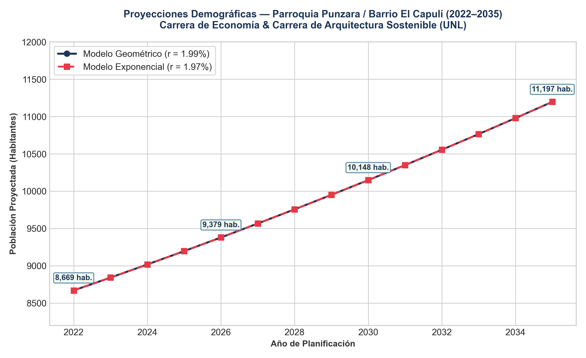

# Introducción y Contexto Territorial

En el marco de las **Prácticas Preprofesionales Finales** de la Carrera de Economía, oficializadas mediante **Memorando Nro. UNL-FJSA-CE-2026-0621-M** (08 de octubre de 2026), se desarrolla el diagnóstico integral de la población y el territorio del **Barrio El Capulí** para la **Carrera de Arquitectura Sostenible** de la Universidad Nacional de Loja (UNL).

- **Ubicación Territorial:** Sur del casco urbano de Loja, colindante al margen suroriental del Campus Universitario "La Argelia" (UNL) y en proximidad al Colegio San Gerardo / Capulí Loma.
- **División Político-Administrativa:**
  - Provincia: Loja (`11`)
  - Cantón: Loja (`1101`)
  - Parroquia: Punzara (`110156`) / Circunscripción urbana sur de Loja.
- **Equipo Institucional de Trabajo:**
  - **Dirección de Carrera (Arquitectura Sostenible):** Arq. Alexandra Elizabeth Aguilera Maldonado.
  - **Supervisores Institucionales de Arquitectura:** Arq. Alexandra Aguilera Maldonado y Arq. Pablo Araki (2 arquitectos a cargo).
  - **Docente Responsable de Prácticas (Economía):** Sra. Liliana De Jesus Matailo Yaguana (Docente Titular Agregado 1).
  - **Equipo de Estudiantes Pasantes (Carrera de Economía):**
    1. **Erick Fabricio Condoy Seraquive** (C.I. 1105973737) — Octavo Ciclo
    2. **Amanda Salome Gálvez Macas** (C.I. 1105932394)
    3. **Erick Sebastián Barba Sisalima** (C.I. 1105639569)
- **Fecha de Inicio:** 12 de octubre de 2026.

---

# Objetivos del Levantamiento

## Objetivo General
Levantar, procesar y proyectar la línea base sociodemográfica, habitacional y socioeconómica del Barrio El Capulí para fundamentar las propuestas de ordenamiento territorial, equipamiento y diseño urbano del Proyecto de Vinculación de la Carrera de Arquitectura.

## Objetivos Específicos
1. **Extracción Demográfica (REDATAM / INEC):** Cuantificar la población total desagregada por sexo, estructura de edades (pirámide poblacional), composición de hogares y condiciones habitacionales a nivel de sectores y manzanas censales.
2. **Proyecciones Poblacionales (Stata):** Estimar el crecimiento de la población para los horizontes 2026, 2030 y 2035 mediante modelos de crecimiento intercensal (geométrico y exponencial).
3. **Análisis Geoespacial y Cartográfico (QGIS):** Georreferenciar la información censal a nivel de manzana/sector, generando mapas de calor de densidad poblacional, mapas de necesidades básicas insatisfechas (NBI) y déficit de equipamiento urbano.
4. **Articulación Técnica-Económica:** Proveer a los estudiantes y docentes de Arquitectura matrices de demanda de servicios, equipamiento barrial y viabilidad socioeconómica.

---

# Marco Metodológico Operativo

El flujo de trabajo cuantitativo y territorial se estructura en cuatro fases complementarias:

```
┌─────────────────────────────────┐
│       1. EXTRACCIÓN REDATAM     │ -> Censo de Población y Vivienda (CPV)
│       (INEC Censo 2022/2010)    │    Variables de personas, hogares y viviendas
└────────────────┬────────────────┘
                 │
                 ▼
┌─────────────────────────────────┐
│     2. MODELACIÓN EN STATA      │ -> Tasas de crecimiento intercensal
│   (Proyecciones Demográficas)   │    Proyecciones a 2030/2035 por cohortes
└────────────────┬────────────────┘
                 │
                 ▼
┌─────────────────────────────────┐
│     3. CARTOGRAFÍA EN QGIS      │ -> Shapefiles de sectores y manzanas censales
│  (Mapas de Calor y Diagnóstico) │    Join espacial, mapas temáticos y buffer de servicio
└────────────────┬────────────────┘
                 │
                 ▼
┌─────────────────────────────────┐
│ 4. ENTREGABLE ARQUITECTURA      │ -> Línea base para diseño de espacios públicos,
│   (Ficha Técnica & Memoria)     │    vialidad, equipamiento comunal y proyectos
└─────────────────────────────────┘
```

---

# Variables Clave a Levantar en REDATAM

| Dimensión | Variable Censal | Indicador Específico | Relevancia para Arquitectura |
| :--- | :--- | :--- | :--- |
| **Demografía** | Sexo y Edad | Pirámide poblacional, índice de dependencia, niñez y adultos mayores | Dimensionamiento de áreas recreativas, centros infantiles o de cuidado. |
| **Vivienda** | Tipo y Calidad de Materiales | Paredes, techo, piso, estado de conservación | Identificación de zonas consolidadas vs. asentamientos precarios. |
| **Servicios** | Cobertura Básica | Agua por red pública, alcantarillado, energía eléctrica, recolección de basura | Determinación de brechas de infraestructura hidrosanitaria. |
| **Hacinamiento** | Personas por dormitorio | Índice de hacinamiento crítico (> 3 personas/habitación) | Déficit cualitativo y cuantitativo de vivienda. |
| **Pobreza NBI** | Necesidades Básicas | Hogares con al menos una NBI insatisfecha | Priorización de intervenciones públicas y regeneración urbana. |

---

# Plan de Trabajo y Cronograma (15 horas semanales)

- **Horario:** Lunes a Viernes, 15:00 a 18:00 (3 horas diarias).
- **Carga Inicial:** 80 horas de intervención coordinada.

| Semana | Hito / Tarea Principal | Responsables | Entregable |
| :---: | :--- | :--- | :--- |
| **Semana 1** | Extracción censal en REDATAM del sector El Capulí y delimitación espacial | Eryck Condoy & Equipo | Tabulados limpios en Excel/CSV y base cruda. |
| **Semana 2** | Modelación demográfica y proyecciones en Stata | Eryck Condoy | Script `.do` y reporte de proyecciones al 2035. |
| **Semana 3** | Carga de cartografía en QGIS, join censal y mapas de calor | Equipo de Economía | Mapas temáticos en alta resolución (`.png`, `.pdf`). |
| **Semana 4** | Levantamiento complementario en territorio y validación de campo | Equipo + Arq. Pablo | Ficha situacional y registro fotográfico. |
| **Semana 5** | Consolidación del informe técnico final de línea base para Arquitectura | Todo el equipo | Memoria técnica y entrega a coordinación. |

---

# Resultados Oficiales del Censo 2022 (Parroquia Punzara / El Capulí)

> **Material de Exposición:** Acceda a las diapositivas ejecutivas del diagnóstico en [presentacion_diagnostico_capuli.html](presentacion_diagnostico_capuli.html).

## 1. Perfil Demográfico Consolidado
- **Población Total Censada:** **8.669 habitantes** distribuidos en 52 sectores censales.
- **Hombres:** 4.354 (50.2%) | **Mujeres:** 4.315 (49.8%).
- **Viviendas Particulares:** 5.382 viviendas.
- **Hogares Censados:** 2.781 hogares (Promedio: 3.12 personas/hogar).

## 2. Pirámide de Población por Grupos Quinquenales

| Grupo de Edad | Hombres | Mujeres | Total Habitantes | % Poblacional |
| :---: | :---: | :---: | :---: | :---: |
| 0 a 4 años | 286 | 279 | 565 | 6.5% |
| 5 a 9 años | 332 | 255 | 587 | 6.8% |
| 10 a 14 años | 394 | 368 | 762 | 8.8% |
| 15 a 19 años | 363 | 379 | 742 | 8.6% |
| **20 a 24 años (Pico Universitario)** | **411** | **371** | **782** | **9.0%** |
| 25 a 29 años | 317 | 319 | 636 | 7.3% |
| 30 a 34 años | 283 | 292 | 575 | 6.6% |
| 35 a 39 años | 222 | 252 | 474 | 5.5% |
| 40 a 44 años | 222 | 264 | 486 | 5.6% |
| 45 a 49 años | 224 | 217 | 441 | 5.1% |
| 50 a 54 años | 213 | 205 | 418 | 4.8% |
| 55 a 59 años | 151 | 224 | 375 | 4.3% |
| 60 a 64 años | 206 | 180 | 386 | 4.5% |
| 65 a 69 años | 207 | 220 | 427 | 4.9% |
| 70 a 74 años | 186 | 148 | 334 | 3.9% |
| 75 a 79 años | 138 | 127 | 265 | 3.1% |
| 80 años y más | 199 | 215 | 414 | 4.8% |
| **Total General** | **4.354** | **4.315** | **8.669** | **100.0%** |

## 3. Balance de Cobertura de Infraestructura y Servicios Básicos

| Servicio Básico | Cobertura Formal (%) | Déficit Territorial (%) | Evaluación Técnica para Arquitectura |
| :--- | :---: | :---: | :--- |
| **Agua Potable por Red** | **19.3%** | **80.7%** | Severo déficit en áreas de expansión; prioridad de pozos y tanques. |
| **Alcantarillado Sanitario** | **38.1%** | **61.9%** | Alta presencia de pozos ciegos/sépticos; riesgo ambiental. |
| **Recolección de Basura** | **49.0%** | **51.0%** | Cobertura intermitente en quebradas y pasajes secundarios. |
| **Energía Eléctrica Formal** | **16.1%** | **83.9%** | Redes provisionales informales y medidores comunitarios. |

---

# Análisis Cartográfico y Mapas Temáticos (QGIS)

Mediante la integración espacial entre la capa censal `sec_a` de `11_loja.gpkg` y la matriz de indicadores del Censo 2022, se generó la **Base Maestra Espacial** con centroides geográficos en coordenadas WGS84 y UTM 17S:

- **Base de datos espacial plana:** [`base_maestra_espacial_punzara.csv`](datos_redatam/base_maestra_espacial_punzara.csv) (con latitud, longitud, área y densidad).
- **Capa vectorial GeoJSON:** [`base_maestra_espacial_punzara.geojson`](cartografia_qgis/base_maestra_espacial_punzara.geojson) (proyectada para QGIS).

## Mapa 1: Densidad Poblacional por Sector Censal
El análisis de densidad espacial evidencia que la mayor concentración habitacional se ubica sobre el eje vial de la Av. Reinaldo Espinosa y el sector colindante al Campus La Argelia:



## Mapa 2: Déficit Crítico de Cobertura de Agua Potable
Se aprecia una fuerte segregación territorial: mientras el casco consolidado cuenta con cobertura parcial, los sectores periurbanos de Capulí Loma presentan un déficit de agua por tubería superior al 80%:



---

# Modelos de Proyección Demográfica (2022–2035)

Para fundamentar la planificación urbana y las propuestas arquitectónicas a corto, mediano y largo plazo, se aplicaron modelos de crecimiento demográfico intercensal tomando como base el período 2010 (6.845 hab.) – 2022 (8.669 hab.):

- **Tasa geométrica intercensal:** $r_{geom} = 1,988\%$ anual
- **Tasa exponencial intercensal:** $r_{exp} = 1,969\%$ anual

## Horizontes Clave de Planificación

| Año | Horizonte Temporal | Modelo Geométrico ($P_t$) | Modelo Exponencial ($P_t$) | Incremento Poblacional |
| :---: | :--- | :---: | :---: | :---: |
| **2022** | Año Base Censal Oficial | 8.669 hab. | 8.669 hab. | — |
| **2026** | **Año de Prácticas Actual** | **9.379 hab.** | **9.379 hab.** | **+710 habitantes** |
| **2030** | Mediano Plazo (Fin de Década) | **10.148 hab.** | **10.148 hab.** | **+1.479 habitantes** |
| **2035** | Largo Plazo (Plan Urbano) | **11.197 hab.** | **11.197 hab.** | **+2.528 habitantes** |



---

# Matriz Institucional de Indicadores (Metodología UNL)

Siguiendo el estándar metodológico institucional de levantamiento territorial de la Carrera de Economía (utilizado en el diagnóstico de Guayquichuma), se estructura la matriz de 4 componentes:

> Documento completo disponible en: [matriz_indicadores_unl_el_capuli.md](fichas_levantamiento/matriz_indicadores_unl_el_capuli.md).

## 1. Datos Generales del Territorio
- **Ubicación Geográfica:** Latitud 3.9984° S, Longitud 79.2012° W (Centroide Barrial).
- **Coordenadas UTM (Zona 17S):** X: 700.120 m E, Y: 9.558.240 m N.
- **Superficie del Área de Estudio:** 3.842,50 ha (38,42 km²).
- **Altitud y Clima:** 2.150 a 2.380 m.s.n.m. \| Temperatura media: 16,1 °C \| Precipitación: 850–950 mm/año.
- **Densidad Poblacional Bruta:** 225,6 hab/km² (con zonas urbanas concentradas > 1.200 hab/km²).

## 2. Componente Social
- **Población Total:** 8.669 hab. (4.354 hombres, 4.315 mujeres).
- **Pico Demográfico Estudiantil:** 782 habitantes en el rango de 20 a 24 años.
- **Pobreza por NBI:** 38,4% de los hogares.
- **Déficit de Servicios Básicos:** 80,7% en agua potable formal, 61,9% en alcantarillado, 51,0% en recolección regular.

## 3. Componente Económico
- **Población Económicamente Activa (PEA):** ~3.950 personas (45,6%).
- **Ramas Principales:** Servicios y comercio barrial (40%), arrendamiento a estudiantes universitarios (30%), construcción (20%).
- **Unidades Económicas Barriales:** ~85 establecimientos (tiendas, fotocopiadoras, bazares, comedores).

## 4. Componente Ambiental e Institucional
- **Topografía:** Relieve irregular con pendientes del 15% al 35% en Capulí Loma.
- **Riesgo:** Susceptibilidad media-alta a deslizamientos en época invernal.
- **Institucionalidad:** Proyecto formalizado mediante **Memorando UNL-FJSA-CE-2026-0621-M** entre la Carrera de Economía y la Carrera de Arquitectura Sostenible.

---

# Archivos de Datos y Scripts en el Repositorio

- `datos_redatam/base_maestra_espacial_punzara.csv`: Base maestra plana con coordenadas y variables.
- `datos_redatam/cpv2022_punzara_indicadores_sectores.csv`: Matriz por sectores censales.
- `cartografia_qgis/base_maestra_espacial_punzara.geojson`: Capa geográfica para QGIS.
- `cartografia_qgis/11_loja.gpkg`: GeoPackage oficial del INEC de Loja.
- `scripts/construir_base_maestra_espacial.py`: Script generador de la base espacial y mapas.
- `scripts/calcular_proyecciones_demograficas.py`: Script generador de proyecciones demográficas.
- `fichas_levantamiento/matriz_indicadores_unl_el_capuli.md`: Ficha técnica de 4 componentes UNL.

