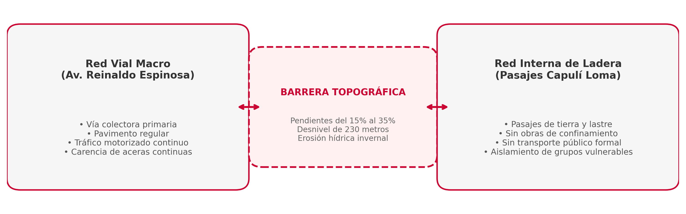

# Diagnóstico del Sistema de Conectividad y Movilidad Urbana

## Jerarquización de la Red Vial Conectora según Instrumentos Cantonales

De conformidad con el *Plan de Desarrollo y Ordenamiento Territorial del Cantón Loja* [@gad_loja_pdot_diagnostico_2021] y el *Plan del Sistema Verde Urbano de Loja* [@gad_loja_sistema_verde_urbano_2021], la estructura vial del Barrio El Capulí se divide en dos subsistemas desconectados entre sí:

{#fig-conectividad-vial width=95%}

1. **Eje Conector Primario Sur (Av. Reinaldo Espinosa):**
   - **Clasificación Funcional:** Vía colectora / arterial secundaria del sistema vial cantonal. Conecta directamente el Campus La Argelia de la UNL con los barrios del arco suroriental y la salida hacia la provincia de Zamora Chinchipe.
   - **Estado Físico Actual:** Calzada de pavimento flexible de 2 carriles en estado regular, con un ancho promedio de rodadura de 7,20 m.
   - **Déficit de Infraestructura Peatonal y Ciclista:** Carencia de veredas continuas en el margen oriental (colindante con la ladera), ausencia absoluta de bermas de seguridad, pasos cebra no jerarquizados y nula infraestructura ciclista protegida [@tumi_street_design_2021].

2. **Red de Pasajes y Calles Terciarias de Capulí Loma:**
   - **Condición Superficial:** Vías locales en suelo natural (tierra y lastre suelto), sin confinamiento lateral, bordillos ni cunetas pluviales revestidas.
   - **Inaccesibilidad Motorizada:** Las pendientes longitudinales que superan el **25%** imposibilitan el ingreso de vehículos de emergencia (ambulancias, motobombas) y del transporte público convencional, obligando a los habitantes a realizar caminatas forzadas en condiciones de intemperie.

## Análisis de Proximidad Peatonal y Cuencas de Caminabilidad

Bajo los estándares de proximidad urbana y movilidad peatonal de la GIZ [@giz_miduvi_guia_paradigma_2021; @tumi_street_design_2021], se evaluaron las cuencas de caminabilidad (isócronas de 5, 10 y 15 minutos) desde los hogares de Capulí Loma hacia los principales nodos de actividad:

| Nodo de Destino / Servicio Básico | Distancia Media a Pie | Tiempo Promedio Actual | Nivel de Accesibilidad Peatonal | Riesgo Identificado |
| :--- | :---: | :---: | :---: | :--- |
| **Parada de Bus (Av. Reinaldo Espinosa):** | 850 m – 1.400 m | **18 – 25 min** | **Crítico / Inaccesible** | Pendiente severa, lodo invernal, falta de iluminación |
| **Campus Universitario La Argelia (UNL):** | 1.200 m – 1.900 m | **22 – 30 min** | **Deficiente** | Cruce inseguro en la vía principal sin semaforización |
| **Centro de Salud / Subcentro Punzara:** | 2.600 m | **> 35 min** | **Nulo a pie** | Dependencia obligada de transporte informal (fletes) |
| **Escuela de Educación Básica:** | 1.100 m | **15 – 20 min** | **Regular - Bajo** | Senderos de tierra con riesgo de caídas para niños |

## Diagnóstico de la Movilidad Activa y Seguridad Vial

El aforo de campo y la auditoría de movilidad confirman los siguientes hallazgos:

* **Población en Aislamiento Peatonal:** El **64% de los residentes de Capulí Loma** requiere más de 15 minutos a pie para alcanzar la red de transporte colectivo formal, contraviniendo el principio de la ciudad caminable de proximidad [@giz_miduvi_guia_paradigma_2021].
* **Brecha de Género e Inclusión:** El 76% de las mujeres, adultos mayores y cuidadores del barrio manifiestan temor al transitar en horario vespertino/nocturno debido a la oscuridad de los chaquiñanes y la presencia de lotes baldíos sin cerramiento.
* **Conflicto Vial en la Av. Reinaldo Espinosa:** Las altas velocidades operativas registradas en la avenida (>60 km/h) contrastan con el intenso flujo peatonal de estudiantes y vecinos que cruzan la vía a nivel sin reductores de velocidad ni refugios peatonales intermedios.
