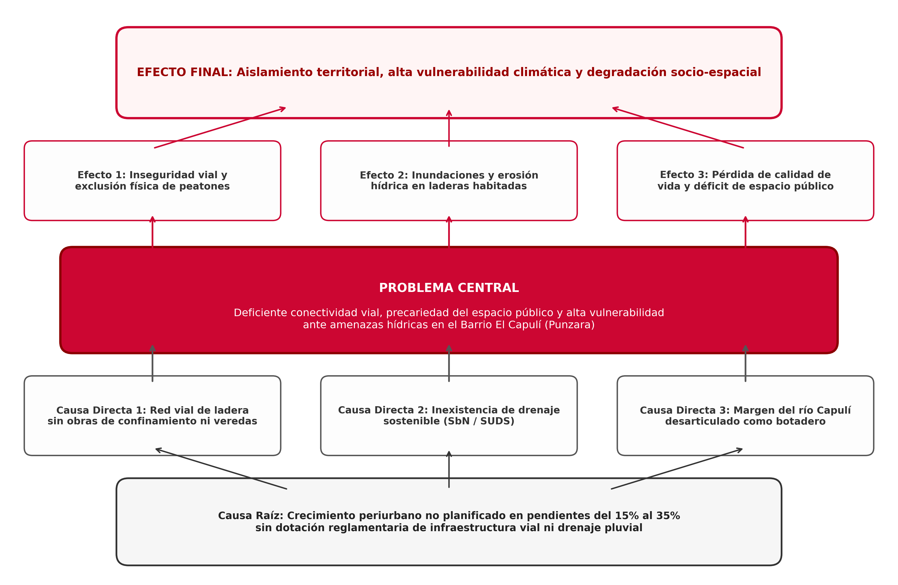
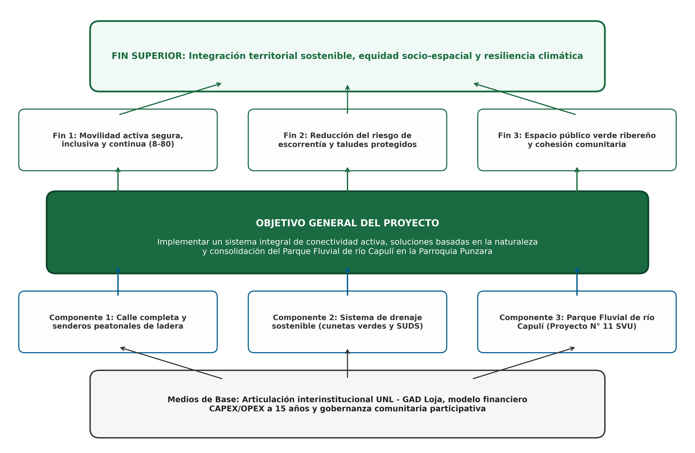

# Matriz de Priorización y Evaluación Multicriterio

## Matriz de Priorización Técnica Multicriterio

Conforme a la metodología de priorización multicriterio adoptada en los procesos de planificación barrial de Loja [@gad_loja_planificacion_barrial_2020] y los estándares de evaluación preliminar de la GIZ [@giz_rosero_perfiles_climaticos_2024], los problemas identificados en el Barrio El Capulí fueron valorados en una escala cuantitativa del 1 al 5 en tres dimensiones operativas:

$$\text{Puntaje de Prioridad} = \text{Gravedad (G)} + \text{Urgencia (U)} + \text{Factibilidad Técnica (F)}$$

| N° | Problemática Urbana / Ambiental | Gravedad (1-5) | Urgencia (1-5) | Factibilidad (1-5) | Puntaje Total (Max 15) | Nivel de Prioridad |
| :-: | :--- | :---: | :---: | :---: | :---: | :---: |
| **P1** | **Incomunicación peatonal y falta de drenaje pluvial en Capulí Loma** | 5 | 5 | 4 | **14** | **Prioridad 1 (Muy Alta)** |
| **P2** | **Déficit crítico de red pública de agua potable en sectores altos** | 5 | 5 | 3 | **13** | **Prioridad 2 (Alta)** |
| **P3** | **Deterioro ecológico y botadero clandestino en Quebrada El Capulí** | 4 | 4 | 4 | **12** | **Prioridad 3 (Media-Alta)** |
| **P4** | **Inseguridad peatonal y falta de aceras en Av. Reinaldo Espinosa** | 4 | 4 | 4 | **12** | **Prioridad 4 (Media-Alta)** |
| **P5** | **Carencia de equipamiento comunal, recreativo y deportivo consolidado** | 3 | 3 | 4 | **10** | **Prioridad 5 (Media)** |

## Teoría de Cambio y Estructura Causal

A partir de la jerarquización de la problemática P1 y sus interrelaciones territoriales, se formula la **Teoría de Cambio** del proyecto de aceleración bajo el modelo causa-efecto [@giz_rosero_perfiles_climaticos_2024]:

## Diagnóstico Causal y Árbol de Problemas

{#fig-arbol-problemas width=100%}

## Estructura Propositiva y Árbol de Objetivos

{#fig-arbol-objetivos width=100%}

1. **Fin Superior:** Mejoramiento integral del hábitat, equidad socio-espacial y resiliencia climática comunitaria en el Barrio El Capulí.
2. **OBJETIVO GENERAL:** **Implementar un sistema integral de conectividad peatonal activa, drenaje pluvial sostenible mediante Soluciones basadas en la Naturaleza (SbN) y recuperación del espacio público fluvial en el Barrio El Capulí.**
3. **Medios de Primer Nivel (Componentes Técnicos):**
   - **Medio 1:** Habilitación de una red de escalinatas y senderos de ladera 8-80 que reduzcan los tiempos de caminata a menos de 10 minutos.
   - **Medio 2:** Construcción de cunetas verdes, biofiltros y zanjas de infiltración que absorban y disipen la escorrentía invernal.
   - **Medio 3:** Consolidación del Parque de río Capulí como infraestructura verde activa integrada al Sistema Verde Urbano cantonal [@gad_loja_sistema_verde_urbano_2021].
