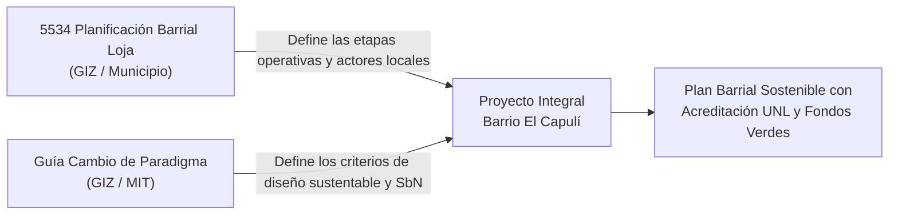

# Postura y Dictamen Técnico: Elección Metodológica para el Proyecto Barrio El Capulí

En el marco de las Prácticas Preprofesionales (Carreras de Economía y Arquitectura Sostenible - UNL), se presenta el análisis comparativo, la justificación de complementariedad y la postura técnica sobre el conjunto de metodologías e instrumentos urbanos desarrollados por la Cooperación Alemana (GIZ Ecuador) y los entes rectores nacional y local.

---

### 1. Radiografía Comparativa de Instrumentos y Guías Metodológicas

| Dimensión | [[guia-paradigma-DIGITAL.pdf](file:///d:/08_Ciclo/03_Practicas_Preprofesionales/lake/raw/guia-paradigma-DIGITAL.pdf)] | [[5534_planificacion-barrial_Loja.pdf](file:///d:/08_Ciclo/03_Practicas_Preprofesionales/lake/raw/5534_planificacion-barrial_Loja.pdf)] | [[5790_Plan_Sistema_Verde_Urbano_Loja.pdf](file:///d:/08_Ciclo/03_Practicas_Preprofesionales/lake/raw/5790_Plan_Sistema_Verde_Urbano_Loja.pdf)] | [[Plan barrial Chamanal Obrapía.pdf](file:///d:/08_Ciclo/03_Practicas_Preprofesionales/lake/raw/Plan%20barrial%20Chamanal%20Obrap%C3%ADa.pdf)] |
| :--- | :--- | :--- | :--- | :--- |
| **Título Oficial** | *Guía Estratégica: Cambio de Paradigma en la Planificación Territorial aplicado al Espacio Público* (2025/2026). | *Guía para la gestión y planificación barrial participativa, Loja* (2019). | *Plan del Sistema Verde Urbano de Loja* (2020). | *Plan barrial participativo Chamanal Obrapía* (Noviembre 2020). |
| **Entidades Autoras** | Ministerio de Infraestructura y Transporte (MIT) + **GIZ Ecuador** (*CIS II*). | GAD Municipal de Loja + **GIZ Ecuador** (*CIS I*). | GAD Municipal de Loja + UTPL + **GIZ Ecuador** (*CIS I*). | GAD Municipal de Loja + Defensoría del Pueblo + **GIZ Ecuador** (*CIS I*). |
| **Nivel / Escala** | **Macro / Estratégica Nacional:** Marco conceptual, estándares urbanísticos, Soluciones basadas en la Naturaleza (SbN), movilidad activa y ciclo de vida del proyecto. | **Micro / Operativa Local (Loja):** Procedimiento paso a paso para organizar un barrio, levantar diagnósticos y trabajar con Juntas Barriales y Promoción Popular. | **Sectorial Cantonal (Loja):** Red estructurante de conectores naturales/artificiales, movilidad alternativa y proyectos ancla en Punzara. | **Microbarrial Ciudadano (19 págs):** Resumen de difusión ejecutiva de talleres comunitarios y priorización de acciones a 1 año. |
| **Rol en el proyecto El Capulí** | **El "QUÉ" y el "HACIA DÓNDE":** Da los criterios técnicos de diseño, sostenibilidad, cambio climático, género y cuidados para el siglo XXI. | **El "CÓMO" y el "CON QUIÉN":** Da el protocolo legal y territorial de Loja para involucrar a la comunidad y estructurar el plan barrial. | **La "CONECTIVIDAD Y VIALIDAD":** Jerarquiza la Av. Reinaldo Espinosa como conector primario sur y define el Parque de río Capulí. | **El "MOLDE NARRATIVO":** Provee el índice y formato estándar de plan barrial homologado por el Municipio. |

---

### 2. ¿Tienen correlación? ¿Por qué la arquitecta pide usar ambas?

Tienen una correlación absoluta porque **pertenecen a la misma línea de desarrollo urbano sostenible de la GIZ en Ecuador**.

* **La Guía de Planificación Barrial de Loja (2019):** Es la herramienta que te dice cómo entrar al territorio lojano: cómo consultar a las directivas, cómo hacer la asamblea comunitaria, cómo dividir el diagnóstico en etapas y cómo articularse con la Jefatura de Promoción Popular del Municipio.
* **La Guía de Cambio de Paradigma (MIT / GIZ):** Es la doctrina urbanística moderna. En la grabación [mar 17.30](file:///d:/08_Ciclo/03_Practicas_Preprofesionales/grabaciones/mar%2017.30%20pr%C3%A1cticas_arq.md#L4-L10) el docente hablaba de *"la ciudad de 15 minutos, cero impacto ambiental, adaptación climática y que el espacio público no es solo adorno, sino red de vida"*. Esa visión sale **textual** de la Guía de Cambio de Paradigma.

**¿Por qué la arquitecta prefiere este enfoque?**
Porque en el urbanismo antiguo, los municipios hacían "canchas de cemento" o parques aislados que pasaban vacíos e inseguros. La Guía de Cambio de Paradigma prohíbe eso y exige:
1. **Ciudad Cercana y Proximidad:** Que los servicios estén a distancia caminable (15 minutos).
2. **Naturaleza como Infraestructura (SbN):** Corredores verdes, protección de quebradas (vital en El Capulí).
3. **Perspectiva de Género y Cuidados:** Espacios seguros e iluminados para mujeres, niños y adultos mayores.
4. **Ciclo de Vida Completo:** Planificar $\rightarrow$ Diseñar $\rightarrow$ Implementar $\rightarrow$ Gestionar con la comunidad.

---

### 3. ¿Cómo se usan en paralelo en El Capulí?

Se usan en un engranaje perfecto de 4 pasos:

1. **En el Diagnóstico:**
   * Usas la estructura de etapas de la **Guía Barrial Loja** (Etapa 1: Diagnóstico Compartido).
   * Pero mides los indicadores de la **Guía de Cambio de Paradigma** (accesibilidad peatonal, proximidad a equipamientos, sombras, drenaje natural frente a riesgos de ladera).
2. **En las Encuestas (KoBoToolbox):**
   * El protocolo de visita comunitaria sigue la **Guía Barrial Loja**.
   * Las preguntas sobre seguridad de mujeres, tiempo de caminata a la parada y residuos orgánicos responden al **Cambio de Paradigma**.
3. **En las Propuestas Arquitectónicas (1°, 2° y 3° ciclo):**
   * Los estudiantes de arquitectura ya no diseñan "plazas duras de hormigón". Diseñan bajo la **Fase 2 (Diseño) de la Guía de Cambio de Paradigma**: diseño bioclimático, materiales sostenibles locales y drenajes sostenibles (evitando deslaves en las pendientes de Capulí Loma).

---

### 4. ¿Existen guías parecidas a la de Cambio de Paradigma?

Sí. La Guía de Cambio de Paradigma se sustenta y conecta con una familia de instrumentos oficiales que la misma GIZ y el gobierno nacional han publicado para Ecuador:

1. **Libro "Ciudades para la Gente" (MIT / GIZ, Cuenca 2025):** Es el manifiesto matriz del que nació la guía estratégica.
2. **Política Ecuatoriana de Espacio Público (PEEP) y Agenda Hábitat Sostenible del Ecuador (AHSE 2036):** Directrices del Ministerio rector de hábitat.
3. **Guía para el Diseño de Corredores Verdes Urbanos - Experiencia Loja (GIZ / Municipio de Loja):** Aplica exactamente estos conceptos al Corredor Verde Oriental de Loja.
4. **Guías Globales de ONU-Hábitat y NACTO (Global Street Design Guide):** Los referentes internacionales citados en el capítulo 3 de la guía (ciudades de 15 minutos, supermanzanas de Barcelona y urbanismo táctico).

---

### En conclusión: Qué decirle a los docentes

Puedes decirles con absoluta solidez:

> *«Hemos revisado a fondo ambos documentos de la GIZ. No solo no se contraponen, sino que encajan perfectamente: la **Guía Barrial de Loja (2019)** nos da la ruta metodológica municipal y el marco de gobernanza comunitaria con las Juntas de Desarrollo Barrial; mientras que la **Guía Estratégica de Cambio de Paradigma (MIT/GIZ 2025)** nos entrega los lineamientos técnicos contemporáneos (SbN, ciudad caminable, mitigación de riesgos de ladera e inclusión) para que las propuestas de diseño de los tres ciclos de arquitectura cumplan con los estándares nacionales y los criterios de elegibilidad para financiamiento verde.»*

---

### 5. ¿Todo lo que necesitamos para competir por el financiamiento está en la Guía Paradigma Digital?

**Pregunta formulada:**  
*«¿Entonces todo lo que necesitamos lo encontramos en la Guía Paradigma Digital para poder competir en el proyecto que vimos en LinkedIn con ese financiamiento, verdad?»*

**Dictamen Técnico:**  
**SÍ, rotundamente SÍ.** La [Guía Estratégica: Cambio de Paradigma en la Planificación Territorial aplicado al Espacio Público (2025)](file:///d:/08_Ciclo/03_Practicas_Preprofesionales/lake/raw/guia-paradigma-DIGITAL.pdf) es el documento matriz que define los estándares, la rúbrica de evaluación y la estructura de expediente exigida por los fondos concursables climáticos (Premio Hábitat Ecuador, GIZ, Banco de Desarrollo del Ecuador BDE y Banco Alemán KfW).

En su página 6 se certifica textualmente:
> *«A partir de ese compromiso el MIT, con el apoyo de la Cooperación Alemana GIZ Ecuador, avanza en procesos para: [...] **incorporar el concepto de Cambio de Paradigma en los proyectos del Eje 1 del Premio Hábitat Ecuador y publicar la Guía Estratégica para el Espacio Público**».*

---

### 6. Matriz de Alineación: Convocatoria de Financiamiento vs. Guía Paradigma vs. Datos El Capulí

| Criterio Exigido por la Convocatoria de Financiamiento ($1'000.000+) | Dónde está en la Guía Paradigma (`guia-paradigma-DIGITAL.pdf`) | Cómo lo cumple y respalda nuestro Proyecto en El Capulí |
| :--- | :--- | :--- |
| **1. Justificación por Brechas Reales y Datos Duros** (Prohibido proyectos "a dedo" o sin línea base). | **Páginas 73-78 (Fase 1: Línea Base de Calidad de Vida):** Exige medir brechas de accesibilidad efectiva, déficit de servicios y estratificación socioeconómica. | Datos oficiales del **Censo CPV 2022 del INEC procesados en REDATAM** (38.4% NBI, >80% déficit de agua en Capulí Loma, pirámide poblacional). |
| **2. Cambio de Paradigma en Movilidad** (No financiar asfalto vehicular tradicional, sino movilidad activa y caminabilidad). | **Páginas 27-33 (Calles como Red de Vida y Proximidad):** Criterios de "Calle Completa", aceras continuas, pacificación de velocidad, rutas escolares seguras y ciclorrutas. | Jerarquización de la **Av. Reinaldo Espinosa** como conector primario sur y diseño de senderos peatonales de enlace hacia el Campus Universitario La Argelia. |
| **3. Adaptación al Cambio Climático (SbN / SUDS)** (Mitigación de riesgos de deslave e inundación en laderas). | **Páginas 79-80 (Ecología Urbana y "Ciudad Esponja"):** Integración obligatoria de zanjas de infiltración, cunetas verdes y taludes vegetados frente al cemento gris. | Soluciones técnicas para las pendientes del 15% al 35% de Capulí Loma y la integración hidráulica del **Parque de río Capulí** (Proyecto N° 11 del Plan SVU). |
| **4. Estructura Oficial del Expediente Técnico** (Checklist estandarizado de presentación). | **Páginas 82-84 (Productos Mínimos del Cierre de Diseño):** Ficha con trazabilidad, planimetría con criterio "8-80", programa de usos multifuncionales y reglas de convivencia. | Estructura formal de carpetas técnicas que desarrollarán los estudiantes de 1°, 2° y 3° ciclo de arquitectura junto con economía. |
| **5. Sostenibilidad Financiera del Ciclo de Vida** (Evaluación de inversión y operación futura). | **Páginas 80, 83 (Cálculo de CAPEX + OPEX a 5, 10 y 15 años):** Obligatoriedad de proyectar no solo el costo de obra (CAPEX), sino la operación, mantenimiento y reposición (OPEX). | Presupuesto y modelo de co-gestión articulado entre el GAD Municipal de Loja y el Comité Barrial El Capulí. |
| **6. Marco Nacional de Indicadores y Monitoreo** (Verificación de impacto en calidad de vida). | **Páginas 91-98 (Mecanismo MNI y Sistema SMER):** Batería de tres niveles: indicadores de cumplimiento (habilitantes), de producto (físicos) y de impacto (tiempo de viaje y seguridad). | Medición con el formulario digital **KoBoToolbox**: reducción de tiempo a paradas de bus, eliminación de puntos ciegos e iluminación. |
